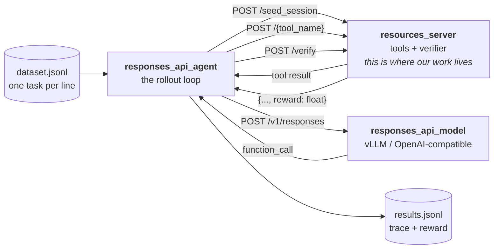

# NeMo Gym: how it actually works, and how we plug into it

Everything below was read out of a real checkout. **Nothing here is from memory** (spec §1.3).

| | |
| --- | --- |
| Source | `https://github.com/NVIDIA-NeMo/Gym` |
| Commit | `ec5a8136046aa0dd0c1525313654502f2fb7c42e` |
| Version | `nemo-gym 0.5.0rc0` |
| Read on | 2026-07-31 |
| Local checkout | `../_vendor/nemo-gym` (outside this repo; `.gitignore`d) |

When you copy a pattern from it into our code, leave the trail:

```python
# Pattern adapted from: nemo-gym/nemo_gym/base_resources_server.py @ commit ec5a8136
```

---

## 1. The mental model

Three processes talk over HTTP. That is the whole architecture.



The single most important consequence: **a reward is just the `reward` field of the JSON that
`POST /verify` returns.** There is no separate reward model, no separate eval harness. That is
exactly the property spec §5.6 asks us to preserve — one verifier, used by both eval and RL.

## 2. Building a resources server

`nemo_gym/base_resources_server.py:133` defines `SimpleResourcesServer`. Subclass it. The base
class's `setup_webserver()` (line 136) already wires four routes:

| Route | Bound to | You override? |
| --- | --- | --- |
| `POST /seed_session` | `self.seed_session` | yes, to build per-rollout state |
| `POST /verify` | `judge_failsafe(self.verify)` | **yes — it is `@abstractmethod`** |
| `POST /aggregate_metrics` | `self.aggregate_metrics` | optional |
| `GET /reverify_mode` | `self.get_reverify_mode` | optional |

It also installs session middleware and `RolloutContextMiddleware`. **Your tools are added by
calling `super().setup_webserver()` first and then registering onto the returned app** — if you
build a fresh `FastAPI()` instead, you silently lose sessions and `/verify`.

Verbatim shape, from `resources_servers/example_session_state_mgmt/app.py`:

```python
class StatefulCounterResourcesServer(SimpleResourcesServer):
    config: StatefulCounterResourcesServerConfig
    session_id_to_counter: Dict[str, int] = Field(default_factory=dict)  # per-rollout state

    def setup_webserver(self) -> FastAPI:
        app = super().setup_webserver()  # <- keeps /seed_session, /verify, sessions
        app.post("/increment_counter")(self.increment_counter)
        app.post("/get_counter_value")(self.get_counter_value)
        return app
```

Three things worth internalising:

1. **The server is a pydantic model, not a plain class.** State is declared as a field with
   `Field(default_factory=dict)`. Passing an unspec'd `MagicMock` as `server_client` fails
   validation — use `MagicMock(spec=ServerClient)` (learned the hard way; see
   `scripts/check_nemo_gym_install.py`).
2. **A route's request body is a pydantic model, and that is also the tool schema.** FastAPI
   generates the OpenAPI entry; the dataset's `tools` array must match it.
3. **`Request` can be injected anywhere** — that is how you reach the session.

### 2.1 Per-rollout state (the bit our sandbox depends on)

```python
from nemo_gym.server_utils import SESSION_ID_KEY


async def increment_counter(self, request: Request, body: IncrementCounterRequest):
    session_id = request.session[SESSION_ID_KEY]  # unique per rollout
    ...
```

One server process serves **many concurrent rollouts**. State keyed by `session_id` is the only
thing keeping them apart. For us, `session_id → sandbox directory` is the entire isolation story:
task 7's agent must never see task 3's files, and two samples of the *same* task must not share a
working copy. `example_session_state_mgmt` is therefore our closest structural template, not
`example_single_tool_call`.

Sessions ride on cookies. The agent threads `resources_server_cookies` from response to next
request (`responses_api_agents/simple_agent/app.py:79,156`) and finally copies them onto the
outgoing response (line 167) *specifically* so `/verify` lands in the same session.

### 2.2 `seed_session` receives the whole task record

In `simple_agent/app.py:176` the agent posts **`body.model_dump()`** — the entire dataset row —
to `/seed_session`. So any extra field you put in the JSONL arrives at session-setup time. That
is how our `task_id` will reach sandbox creation without inventing a side channel.

### 2.3 The verify contract

```python
class BaseRunRequest(BaseModel):
    responses_create_params: NeMoGymResponseCreateParamsNonStreaming  # line 88


class BaseVerifyRequest(BaseRunRequest):
    response: NeMoGymResponse  # line 92, the full trace


class BaseVerifyResponse(BaseVerifyRequest):
    reward: float  # line 96
```

The response **echoes the request and adds `reward`** — that is why every example ends with
`return BaseVerifyResponse(**body.model_dump(), reward=reward)`. The output JSONL is therefore
self-contained: prompt, trace and reward on one line. Our `analysis/` code can read it directly.

`BaseMultiRewardVerifyResponse` (line 100) adds `reward_components: dict[str, float]`. We will
**subclass it** so `reward_v1` ships alongside its per-gate breakdown, which is what makes the
failure taxonomy in B4 computable after the fact instead of requiring a re-run. Note its docstring
warning: metrics **do not descend into that mapping**, so anything we want aggregated must also be
a top-level field.

`/verify` is wrapped in `judge_failsafe`, so an exception inside our verifier degrades rather than
killing the batch. Good — but it also means **a silently broken verifier looks like a run of
zeros**. B4 must include a test that a known-good gold patch scores exactly `1.0`.

## 3. The agent loop, in full

`responses_api_agents/simple_agent/app.py`. `responses()` (line 65) is a `while True`:

1. POST the conversation to the model server's `/v1/responses`.
2. Extend `new_outputs` with the model's output items.
3. `break` if `incomplete_details` is set (line 118).
4. Split output into `function_call` items and assistant `message` items (lines 121–124).
   **`break` if there are no tool calls *and* at least one assistant message** — i.e. the model
   stops when it stops calling tools.
5. For each tool call: `json.loads` the arguments; on failure, feed the error back as a
   `function_call_output` and continue (lines 133–146) — malformed JSON does not crash the batch.
6. `POST /{function_call.name}` on the resources server (line 148). Note: **no `raise_for_status`
   here, deliberately** — a 4xx/5xx body is handed to the model as the tool result. Our tool
   errors are therefore *prompts*, which is precisely why §5.5 demands they be short and
   instructive.
7. `break` if `max_steps` is reached (line 163).

`run()` (line 175) is the whole rollout: `/seed_session` → `/v1/responses` → `/verify`.

**Implication for our `submit()` tool.** The loop has no notion of "the agent is finished"
beyond "it stopped calling tools". `submit()` is our own convention, enforced in the verifier
(the `no_submit` hard-zero gate of §5.7), not by the harness. Worth stating plainly in
`docs/reward_design.md`.

## 4. Task record format

One JSON object per line. Real example (`example_session_state_mgmt/data/example.jsonl`):

```json
{"responses_create_params": {"input": [{"content": "add 1 then add 2 then get the count", "role": "user"}],
                             "tools": [{"type": "function", "name": "increment_counter", "strict": true,
                                        "parameters": {"type": "object",
                                                       "properties": {"count": {"type": "integer", "description": ""}},
                                                       "required": ["count"], "additionalProperties": false},
                                        "description": ""}]},
 "expected_count": 6, "initial_count": 3}
```

- `responses_create_params.input` — the prompt.
- `responses_create_params.tools` — OpenAI function-tool schema. `strict: true` with
  `additionalProperties: false` is the norm here; we should match it so small models get
  constrained decoding.
- **Everything else is ours.** `expected_count` lands in the verify request; `initial_count`
  lands in `seed_session`. Our equivalent will carry `task_id` plus the §5.1 verification block.

`benchmark/tools/build_catalogue.py` will generate these from `task.yaml`, so the YAML stays the
single source of truth and the JSONL is a build artefact.

## 5. Config wiring

`resources_servers/<name>/configs/<name>.yaml` declares two things: the environment, and an
agent bound to it.

```yaml
example_session_state_mgmt_resources_server:
  resources_servers:
    example_session_state_mgmt:
      entrypoint: app.py
      domain: agent
      verified: false
      description: Session state management (in-memory)

example_session_state_mgmt_simple_agent:
  responses_api_agents:
    simple_agent:
      entrypoint: app.py
      resources_server: {type: resources_servers, name: example_session_state_mgmt_resources_server}
      model_server:    {type: responses_api_models, name: policy_model}
      datasets:
        - {name: train,      type: train,      jsonl_fpath: .../data/train.jsonl}
        - {name: validation, type: validation, jsonl_fpath: .../data/validation.jsonl}
        - {name: example,    type: example,    jsonl_fpath: .../data/example.jsonl}
```

`policy_model` resolves through `env.yaml` at the Gym root:

```yaml
policy_base_url: http://localhost:8000/v1
policy_api_key: <key>
policy_model_name: Qwen/Qwen2.5-Coder-1.5B-Instruct
```

Mirrored in our `.env.example`. Note the `train`/`validation`/`example` dataset-type convention —
our `train` / `heldout` split maps onto `train` / `validation`.

### CLI

```bash
gym list resources-servers                 # also: benchmarks, environments, agents, models
gym env validate
gym env start --resources-server <name> --model-type openai_model
gym eval run --no-serve --agent <name>_simple_agent \
             --input data/example.jsonl --output results/out.jsonl --limit 5 --num-repeats 1
```

`--num-repeats` is how pass@k data gets generated (§6.2 design choice 4: k=8).

## 6. Which built-in harness should we start from?

Surveyed the hub at this commit: **101 resources servers, 33 agents**.

| Candidate | Why we looked | Verdict |
| --- | --- | --- |
| `simple_agent` | the reference loop | ✅ **base for our agent.** ~200 lines, tool-call loop + `max_steps`, no assumptions about the domain. Our subclass only needs turn/tool-call accounting for §5.5's `max_turns` / `max_tool_calls`. |
| `example_session_state_mgmt` | per-rollout state | ✅ **base for our server.** Exactly the `session_id → resource` pattern our sandbox needs. |
| `example_tool_call_multireward` | `reward_components` | ✅ pattern for shipping `reward_v1` + gate breakdown together. |
| `mini_swe_agent`, `mini_swe_agent_2`, `swe_agents`, `anyswe_agent` | SWE-style repo tasks | ⚠️ closest prior art. Worth mining for repo mounting and patch extraction, but they assume a shell tool and Docker-ish sandboxes. Our §5.5 surface is a **fixed 6 tools, no shell**, which is a deliberate difference (smaller action space for a 1.5B model). |
| `verifiers_agent` | token IDs / logprobs | ⚠️ revisit at training time if the trainer wants pre-tokenised traces. |
| `code_gen`, `bigcodebench`, `evalplus`, `competitive_coding_challenges`, `code_fim` | code + tests | ❌ single-file function-completion benchmarks. No repo, no multi-turn editing. Different task shape from ours. |
| `cvdp` | NVIDIA's own code/verification env | ⚠️ worth a read before B5; hardware-verification oriented. |

**Does a suitable SWE-style environment already exist?** Partly — the `*swe_agent*` family covers
repo-level agentic coding, but nothing in the hub provides a *small, self-contained, gold-patched,
hidden-test* benchmark of the kind §5 specifies. Recorded as
[ADR 0005](decisions/0005-build-our-own-environment-rather-than-reuse-swe-agents.md).

## 7. What we ran here, and what we could not

### Ran, unmodified ✅

`scripts/check_nemo_gym_install.py` drives two shipped environments through their real FastAPI
apps. Output: [results/raw/b0_nemo_gym_builtin/report.json](../results/raw/b0_nemo_gym_builtin/report.json).

| Environment | Exercised | Result |
| --- | --- | --- |
| `example_single_tool_call` | `POST /get_weather`, `POST /verify` | 200; **reward 1.0** |
| `example_session_state_mgmt` | `/seed_session` → 2× `/increment_counter` → `/get_counter_value` → `/verify` | counter **22** as expected; **reward 1.0**; 1 live session |

Their own pytest suites also pass unmodified (`example_single_tool_call`, `example_multi_step`,
`example_session_state_mgmt` — 1 passed each).

That covers config validation, server construction, session middleware, tool routing, per-rollout
state and the verifier — every surface we subclass.

### Our own environment, over HTTP ✅ (B3)

`scripts/smoke_one_task.py --transport gym` builds `envs/coding_env/app.py`'s real FastAPI app
and drives a full episode through it with Starlette's TestClient:
`/seed_session` → `/list_files` → `/read_file` → `/write_file` → `/run_tests` → `/submit` →
`/verify`. Run with the Python 3.12.10 interpreter in `_vendor/nemo-gym/.venv` and the
`_vendor/win_compat` shim on `PYTHONPATH`.

Result: **reward 1.00, 12/12 hidden tests, 0 gates, 5 tool calls, 0 live sessions afterwards** —
identical to the same episode run with `--transport direct`, which is the §5.6 invariant holding in
practice rather than by assertion. Output:
[results/raw/b3_smoke/gym.json](../results/raw/b3_smoke/gym.json).

So the resources server, the session middleware and `POST /verify` **are** verified on this
machine. What is still unverified is the multi-process orchestration below.

### Could not run here ❌
`gym env start` boots a Ray cluster, and **Ray's raylet does not start on native Windows**:

```
Failed to start the dashboard
GCS cannot find the node with node ID 4c2f521c... The node registration may not be complete yet
Exception: The current node timed out during startup.
  at nemo_gym/server_utils.py:492 in initialize_ray -> ray.init(**ray_init_kwargs)
```

Not worth fighting: NeMo Gym's own README lists Windows as supported **via WSL2 only**. So the
multi-process orchestration path — process supervision, real sockets, `gym eval run` — is
**unverified on this machine**. It is a documented gap, not a silent one:
`docs/TRAINING_READINESS.md` §5 lists "run `make smoke-gym` on Linux/WSL2" as a blocker to clear
before training.

### Windows workarounds used (none touch NeMo Gym source)

| Problem | Cause | Workaround |
| --- | --- | --- |
| `ModuleNotFoundError: 'resource'` | `nemo_gym/server_utils.py:18` imports the POSIX module unconditionally; used only by `SimpleServer.set_ulimit()` | a shim on `PYTHONPATH` providing `RLIMIT_*`, `getrlimit`, `setrlimit`, `getpagesize` |
| `uvloop` won't build | no Windows wheels; **declared but never imported** by NeMo Gym | `UV_OVERRIDE` with `uvloop; sys_platform != "win32"` |
| `ray` has no matching wheel | `win_amd64` wheels stop at cp312 | use Python 3.12.10 |

These live in `../_vendor/`, deliberately outside this repo. **The lesson shaped the design**
(ADR 0002): our sandbox, tools, verifier and reward carry **zero `nemo_gym` imports**, and
`app.py` is a thin adapter. So `make validate`, `make test` and `make smoke` work on any OS, while
only `make smoke-gym` needs the full stack.

## 8. Gotchas worth remembering

1. `setup_webserver()` **must** call `super()` first, or you lose `/verify` and sessions.
2. Server classes are pydantic models — declare state as fields, not in `__init__`.
3. Tool endpoints are **not** `raise_for_status`ed; error bodies become model input. Write them
   as instructions to a 1.5B model.
4. `/verify` runs under `judge_failsafe` — test the happy path explicitly or a broken verifier
   just looks like bad training.
5. Cookies carry the session; drop them and `/verify` sees a fresh, empty session.
6. `seed_session` gets the **whole** dataset row.
7. Extra JSONL fields need `model_config = ConfigDict(extra="allow")` on your request models
   (as `SimpleAgentRunRequest` does, line 50) or they are dropped.
8. The API is explicitly pre-1.0. Pin the commit; re-read before the training phase.
